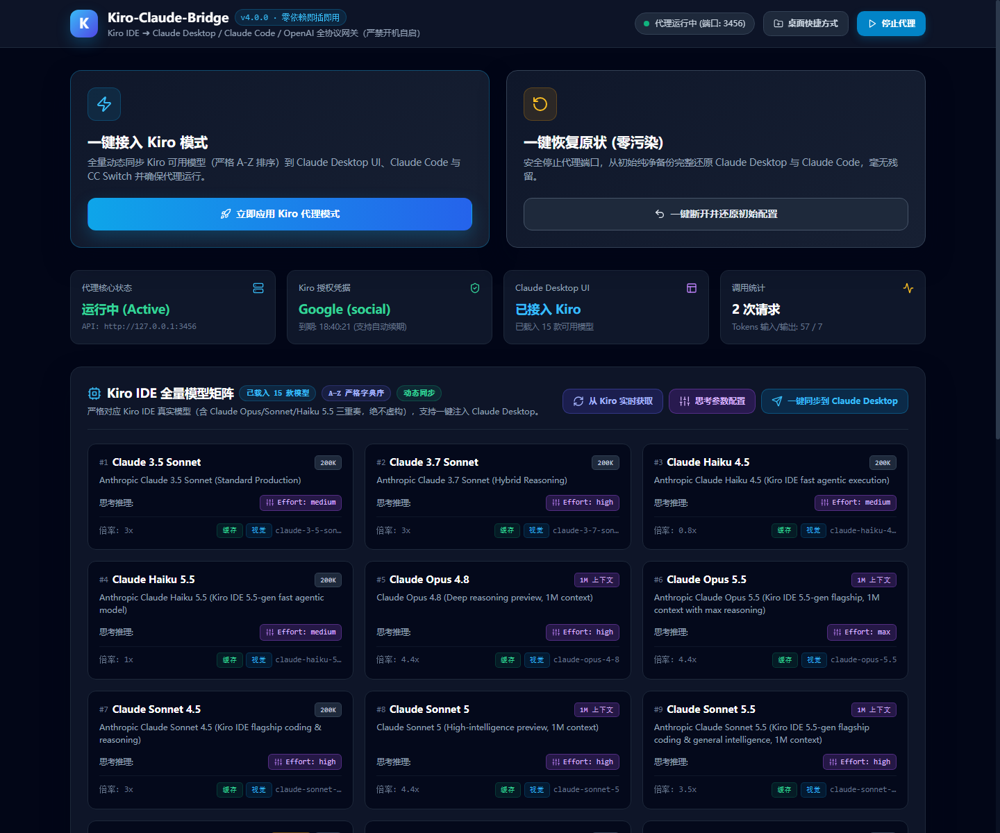

<div align="center">

# Kiro-Claude-Bridge

**Zero-Dependency, Plug-and-Play Gateway & Offline Dashboard bridging Kiro IDE Models to Claude Desktop, Claude Code CLI, and OpenAI Clients**

[](https://github.com/xuarehere/kiro-claude-bridge/actions/workflows/ci-release.yml)
[](LICENSE)
[](#plug-and-play-architecture)
[](#zero-auto-start--zero-pollution-rollback)
[-purple.svg)](#dynamic-model-matrix-a-z)
[](#api-compatibility-endpoints)
[](#quick-start)

[English](README.md) · [简体中文](README_zh.md) · [Changelog](CHANGELOG.md) · [Security](SECURITY.md) · [Contributing](CONTRIBUTING.md)

</div>

---

## Table of Contents

- [Overview](#overview)
- [Comparison with Legacy Tools](#comparison-with-legacy-tools)
- [Quick Start](#quick-start)
- [Client Integration & Code Examples](#client-integration--code-examples)
- [Plug-and-Play Architecture](#plug-and-play-architecture)
- [Dynamic Model Matrix (A-Z)](#dynamic-model-matrix-a-z)
- [API Compatibility Endpoints](#api-compatibility-endpoints)
- [Configuration & Environment Variables](#configuration--environment-variables)
- [Zero Auto-Start & Zero-Pollution Rollback](#zero-auto-start--zero-pollution-rollback)
- [Project Structure](#project-structure)
- [Troubleshooting & FAQ](#troubleshooting--faq)
- [Roadmap & Contributing](#roadmap--contributing)

---

## Overview

**Kiro-Claude-Bridge** is a 100% standalone, zero-dependency local reverse proxy and offline management console that dynamically mirrors **Kiro IDE's live available models (strictly sorted A–Z)**—including the complete **Claude 5.5 Trio** (`Claude Opus 5.5`, `Claude Sonnet 5.5`, `Claude Haiku 5.5`), **DeepSeek v3.2**, **Qwen3 Coder Next**, **GLM 5**, **MiniMax M2.5 / M2.1**, and cloud flagship tiers when enabled on your Kiro account—directly inside **Claude Desktop (`claude-desktop.exe`)**, **Claude Code CLI**, and any OpenAI-compatible client (Cursor, Continue, Cline, OpenWebUI, SDKs).

No `@colin3191/kiro-proxy` package required. No `npm install` required. No external Web CDNs. **Strictly zero OS auto-start.**



---

## Comparison with Legacy Tools

| Capability | Legacy Proxy Setup | Kiro-Claude-Bridge v4 |
| :--- | :--- | :--- |
| **Runtime Dependencies** | Global npm + `@colin3191/kiro-proxy` + Express + Python | **0 npm dependencies** (pure Node.js built-ins + offline CSS/SVG UI) |
| **Distribution & Launch** | Global CLI install & manual config hacking | **Source ZIP runs without `npm install`**; **Portable ZIP bundles `node.exe`** |
| **OS Auto-Start Policy** | Injects Windows `Startup` `.lnk` & hidden `.vbs` | **Strictly Zero Auto-Start** (on-demand launch, clean stop) |
| **Claude Desktop Dropdown** | Drops non-Anthropic models down to ~3 items (`cEt` filter) | **All active models shown strictly A–Z** via `cEt`-bypass routing |
| **Claude 5.5 Coverage** | Incomplete (`claude-opus-5.5` only or fabricated names) | **Authentic Trio**: Opus 5.5 (1M), Sonnet 5.5 (1M), Haiku 5.5 (200K) |
| **Kiro Live Catalog Sync** | Static model list breaks when Kiro rotates models | **Live-catalog-aware routing** + one-click Live Fetch |
| **Effort / Thinking Control** | Hardcoded or throws `additionalModelRequestFields` errors | **Schema-bound per model** + wire-capability validation |
| **Port Conflict Handling** | Fails silently with `EADDRINUSE` | **Live PID diagnostics, HTTP 409 details, one-click takeover or port switch** |
| **Rollback & Cleanup** | Manual JSON / SQLite editing | **Atomic zero-pollution rollback** from pristine `.backups/` |

---

## Quick Start

> **Prerequisite**: Install and log in once via [Kiro IDE](https://kiro.dev/) so your local SSO cache exists at `~/.aws/sso/cache/kiro-auth-token.json`.

### Option A: From GitHub Source (Zero `npm install` Required)
Requires **Node.js >= 18.0.0** (Node 22.5+ enables native `node:sqlite` for zero-Python CC Switch sync).
1. Download & extract the [Source ZIP](https://github.com/xuarehere/kiro-claude-bridge/releases) (or run `git clone https://github.com/xuarehere/kiro-claude-bridge.git`).
2. **Windows**: Double-click **`start-web.bat`** in the project root folder (or inside `scripts/`).  
   **macOS / Linux**: Run `./start.sh` (or `node src/index.js --open`).
3. The offline dashboard opens automatically at **`http://localhost:3457`**.

### Option B: Portable Windows Release (No Node.js Installation Required)
1. Download `kiro-claude-bridge-win-x64-portable-v*.zip` from [GitHub Releases](https://github.com/xuarehere/kiro-claude-bridge/releases).
2. Extract anywhere and double-click **`start-web.bat`** — the launcher detects the bundled `./runtime/node.exe` automatically.

### Connect Clients in 1 Click
1. Click **"一键接入 Kiro 模式"** in the Web Dashboard (`http://localhost:3457`).
2. Launch **`claude-desktop.exe`** or **`claude` (Claude Code CLI)** — all active Kiro models appear sorted **A–Z**.
3. When finished, click **"一键恢复原状 (零污染)"** or double-click **`restore.bat`** to roll back every external config cleanly.

---

## Client Integration & Code Examples

### 1. Claude Desktop (`claude-desktop.exe`) & Claude Code CLI
Clicking **"一键接入 Kiro 模式"** automatically backs up and configures:
- **Claude Desktop 3P Gateway** (`Claude-3p/configLibrary/00000000-0000-4000-8000-000000157210.json` + `_meta.json` upsert)
- **Claude Code CLI** (`~/.claude/settings.json` with `ANTHROPIC_BASE_URL=http://127.0.0.1:3456`)
- **CC Switch SQLite DB** (`~/.cc-switch/cc-switch.db`, updated via built-in `node:sqlite`)

### 2. Direct API Calls (`curl` & OpenAI / Anthropic SDKs)

<details>
<summary><b>Anthropic Messages API (`POST /v1/messages`) & Token Counting</b></summary>

```bash
curl http://127.0.0.1:3456/v1/messages \
  -H "Content-Type: application/json" \
  -d '{
    "model": "claude-opus-5-5",
    "max_tokens": 512,
    "effort": "max",
    "messages": [{ "role": "user", "content": "Explain event loops concisely." }]
  }'
```

</details>

<details>
<summary><b>OpenAI Chat Completions (`POST /v1/chat/completions`) for Cursor / Cline / SDKs</b></summary>

```javascript
import OpenAI from 'openai';

const client = new OpenAI({
  baseURL: 'http://127.0.0.1:3456/v1',
  apiKey: 'kiro-local-bridge',
});

const res = await client.chat.completions.create({
  model: 'deepseek-3.2',
  messages: [{ role: 'user', content: 'Write a quicksort in JS.' }],
});
console.log(res.choices[0].message.content);
```

</details>

---

## Plug-and-Play Architecture

```text
  ┌──────────────────────────────────────────────────────────────────────┐
  │  Clients: Claude Desktop · Claude Code CLI · Cursor · OpenAI SDKs    │
  └───────────────┬────────────────────────────────────┬─────────────────┘
                  │ Anthropic Messages + count_tokens  │ OpenAI Chat + Responses
                  ▼                                    ▼
  ┌──────────────────────────────────────────────────────────────────────┐
  │  Kiro-Claude-Bridge Proxy (:3456)  &  Offline Web Dashboard (:3457)  │
  │   ├── Zero-Dep HTTP Router & Static Engine (src/utils/http-app.js)   │
  │   ├── Live-Aware cEt-Bypass Model Router (src/proxy/model-router.js) │
  │   ├── Schema-Bound Effort / Thinking Resolver (settings-manager.js)  │
  │   ├── Cross-Platform Port Diagnostics & Takeover (port-manager.js)   │
  │   └── Bi-Directional AWS EventStream Adapter (src/kiro/runtime.js)   │
  └───────────────┬──────────────────────────────────────────────────────┘
                  │ Bearer Auth + Auto Refresh (Social Google/GitHub & AWS IdC)
                  ▼
  ┌──────────────────────────────────────────────────────────────────────┐
  │              Kiro Management & Runtime Control Plane                 │
  └──────────────────────────────────────────────────────────────────────┘
```

### Key Technical Mechanisms
1. **Claude Desktop `cEt` Regex Bypass**: Claude Desktop's `app.asar` strips third-party identifiers matching `/deepseek|glm|gpt|grok|kimi|minimax|qwen|.../`. The bridge maps them to compliant `claude-kiro-*` identifiers with friendly A–Z `labelOverride` strings and routes them transparently back to live Kiro backend targets.
2. **Wire-Safe Live Fallback & Effort Clamping**: If Kiro rotates a cloud model tier out on your account (e.g., `gpt-5.6-sol` unavailable), `resolveEffectiveModel()` routes to your live active `defaultModelId` and verifies `wireModelMeta.effortLevels` before emitting `additionalModelRequestFields`, eliminating `Invalid model ID` and unsupported field errors.

---

## Dynamic Model Matrix (A-Z)

Models are fetched dynamically from Kiro's `/listAvailableModels` control plane combined with Kiro's Native Claude catalog (usually **15 to 20+ models** depending on your account tier and Kiro rollout) and sorted **strictly A–Z**:

| Model Name | Desktop Gateway ID | Context | Effort Schema Support |
| :--- | :--- | :---: | :--- |
| **Claude 3.5 Sonnet** | `claude-3-5-sonnet` | 200K | `none, low, medium, high` |
| **Claude 3.7 Sonnet** | `claude-3-7-sonnet` | 200K | `none, low, medium, high, max` |
| **Claude Haiku 4.5** | `claude-haiku-4-5` | 200K | `none, low, medium, high` |
| **Claude Haiku 5.5** *(Trio)* | `claude-haiku-5-5` | 200K | `none, low, medium, high` |
| **Claude Opus 4.8** | `claude-opus-4-8` | 1M | `none, low, medium, high, xhigh, max` |
| **Claude Opus 5.5** *(Trio)* | `claude-opus-5-5` | 1M | `none, low, medium, high, xhigh, max` |
| **Claude Sonnet 4.5** | `claude-sonnet-4-5` | 200K | `none, low, medium, high, xhigh, max` |
| **Claude Sonnet 5** | `claude-sonnet-5` | 1M | `none, low, medium, high, xhigh, max` |
| **Claude Sonnet 5.5** *(Trio)* | `claude-sonnet-5-5` | 1M | `none, low, medium, high, xhigh, max` |
| **DeepSeek v3.2** | `claude-kiro-v32` | 164K | *Fixed (non-reasoning)* |
| **GLM 5** | `claude-kiro-general5` | 200K | *Fixed (non-reasoning)* |
| **Kirin Inference GLM** | `claude-kiro-kirin` | 128K | *Fixed (non-reasoning)* |
| **MiniMax M2.1 / M2.5** | `claude-kiro-m21` / `m25` | 196K | *Fixed (non-reasoning)* |
| **Qwen3 Coder Next** | `claude-kiro-coder` | 256K | *Fixed (non-reasoning)* |
| **GPT 5.6 / Grok 4.7 / Kimi K3** | `claude-kiro-*` | 500K–1M | *Dynamically surfaced when enabled by Kiro* |

---

## API Compatibility Endpoints

Default proxy base: `http://127.0.0.1:3456` (loopback-restricted for credential safety).

| Protocol | Method & Path | Purpose |
| :--- | :--- | :--- |
| **Anthropic** | `POST /v1/messages` | Streaming SSE & JSON messages, tool use, effort resolution, client disconnect abort |
| **Anthropic** | `POST /v1/messages/count_tokens` | Input token estimation required by Claude Code CLI |
| **OpenAI** | `POST /v1/chat/completions` | Chat Completions streaming/JSON + tool calls |
| **OpenAI** | `POST /v1/responses` | Responses API streaming (`response.output_text.delta`) & JSON |
| **Discovery** | `GET /v1/models`, `GET /q/models` | Normalized live model list sorted A–Z |
| **Operations** | `GET /health`, `GET /credits` | Kiro SSO token status & local usage counters |

---

## Configuration & Environment Variables

See [.env.example](.env.example). Ports can also be switched dynamically in the Web Dashboard and persisted to `config/bridge-config.json`.

| Variable | Default | Description |
| :--- | :--- | :--- |
| `PROXY_PORT` | `3456` | Local reverse proxy port |
| `WEB_PORT` | `3457` | Offline Web Dashboard port |
| `KIRO_VERSION` | `1.0.231` | Reported Kiro User-Agent version |
| `KIRO_RUNTIME_ENDPOINT` | `https://runtime.us-east-1.kiro.dev` | Kiro Runtime base URL |

---

## Zero Auto-Start & Zero-Pollution Rollback

- **Zero Auto-Start**: Never touches Windows `Startup`, `HKCU\...\Run`, scheduled tasks, LaunchAgents, or systemd units.
- **Pristine Backups**: First write automatically archives original Claude Desktop, Claude Code, and CC Switch configs into `.backups/`.
- **One-Click Restore**: Run `restore.bat` (Windows) or `npm run restore` to stop all proxy ports and restore original client state atomically.

---

## Project Structure

```text
kiro-claude-bridge/
├── start-web.bat / stop.bat / restore.bat   # Root Windows 1-click launchers (Pure ASCII + CRLF)
├── start.sh / stop.sh                       # macOS / Linux launchers
├── bin/kiro-bridge.js                       # CLI entry point
├── config/model-settings.json               # User Effort & Thinking preferences
├── scripts/                                 # Sub-folder launchers, packager & verifier
│   ├── package-release.js                   # Builds Source & Windows Portable ZIPs
│   ├── stop.js / restore.js                 # Cross-platform stop & rollback
│   └── verify-full.js                       # 12-point live E2E verification suite
├── src/
│   ├── adapters/                            # Claude Desktop, Claude Code, CC Switch, Backups
│   ├── config/                              # Dynamic persisted runtime port config
│   ├── kiro/                                # SSO auth refresh, live catalog, EventStream client
│   ├── proxy/                               # HTTP proxy, live router, port diagnostics, effort manager
│   ├── utils/http-app.js                    # Zero-dependency native node:http router & static host
│   └── web/                                 # Web API server & offline Zero-CDN UI assets
└── tests/                                   # Built-in node --test unit & integration tests
```

---

## Troubleshooting & FAQ

- **Port `3456` occupied (`EADDRINUSE`) / Legacy `@colin3191/kiro-proxy` still running?**  
  Open `http://localhost:3457`. The dashboard automatically surfaces the **Port Conflict Diagnostics** banner showing the exact PID & command line, and provides **"⚡ 一键接管端口并启动代理"** (with an option to remove stale legacy Startup shortcuts) or **"🔄 切换至空闲端口 (3458)"**. You can also start via `start-web.bat --takeover`.
- **Kiro token expired?**  
  Social (Google/GitHub) and Enterprise IdC tokens auto-refresh seamlessly in `src/kiro/auth.js`. If a refresh token itself expires, re-login once inside Kiro IDE.

---

## Roadmap & Contributing

- **Testing**: `npm test` (zero-dependency `node --test` suite)
- **Packaging**: `npm run pack` (outputs Source ZIP + self-contained Windows x64 Portable ZIP into `dist/`)
- Contributions are welcome! Please read [CONTRIBUTING.md](CONTRIBUTING.md) and [CODE_OF_CONDUCT.md](CODE_OF_CONDUCT.md).

Released under the [MIT License](LICENSE).
