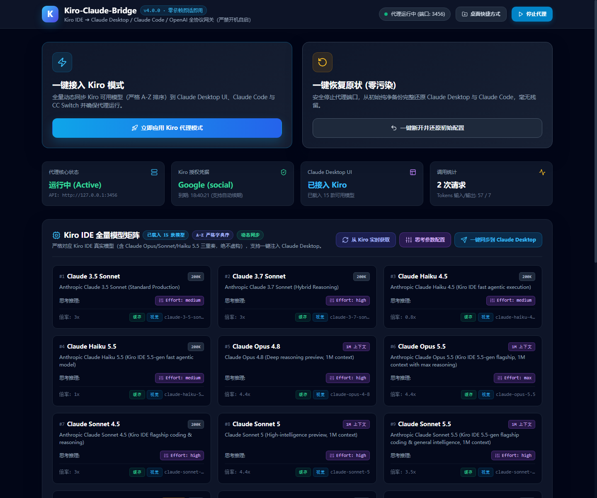

<div align="center">

# Kiro-Claude-Bridge

**零依赖、即插即用 · 严禁开机自启 · 全协议 AI 代理网关与离线控制看板**

[](LICENSE)
[](#零依赖即插即用架构)
[](#严禁开机自启与零污染回滚)
[-purple.svg)](#动态模型矩阵严格-a-z)
[](#api-兼容端点列表)
[](#30-秒极速上手)

[English](README.md) · [简体中文](README_zh.md) · [更新日志](CHANGELOG.md) · [安全说明](SECURITY.md) · [贡献指南](CONTRIBUTING.md)

</div>

---

## 目录导航

- [项目简介](#项目简介)
- [与传统代理方案对比](#与传统代理方案对比)
- [30 秒极速上手](#30-秒极速上手)
- [客户端接入与 SDK 调用示例](#客户端接入与-sdk-调用示例)
- [零依赖即插即用架构](#零依赖即插即用架构)
- [动态模型矩阵（严格 A-Z）](#动态模型矩阵严格-a-z)
- [API 兼容端点列表](#api-兼容端点列表)
- [环境变量配置说明](#环境变量配置说明)
- [严禁开机自启与零污染回滚](#严禁开机自启与零污染回滚)
- [项目目录结构](#项目目录结构)
- [常见问题排查 (FAQ)](#常见问题排查-faq)
- [开发测试与打包](#开发测试与打包)

---

## 项目简介

**Kiro-Claude-Bridge** 是一款 **100% 独立、零外部依赖、开箱即用** 的本地 AI 反向代理与全离线 Web 管理看板，彻底告别 `@colin3191/kiro-proxy`、重型 npm 依赖及外网 CDN，实时聚合 **Kiro IDE 当前全部真实可用大模型（严格按 A–Z 字典序排序）**——包含完整的 **Claude 5.5 三重奏**（`Claude Opus 5.5`、`Claude Sonnet 5.5`、`Claude Haiku 5.5`）、**DeepSeek v3.2**、**Qwen3 Coder Next**、**GLM 5**、**MiniMax M2.5 / M2.1** 及 Kiro 账号所开通的云端旗舰模型——无缝接入 **Claude Desktop (`claude-desktop.exe`)**、**Claude Code CLI** 与所有 OpenAI 协议客户端（Cursor、Continue、Cline、OpenWebUI 等）。

**无需 `npm install` · 无需外网 CDN · 严禁任何开机自启。**



---

## 与传统代理方案对比

| 核心维度 | 传统代理工具方案 | Kiro-Claude-Bridge v4 |
| :--- | :--- | :--- |
| **外部包依赖** | 需全局安装 `@colin3191/kiro-proxy` + Express + Python | **0 个 npm 第三方包**（纯 Node.js 原生内置 + 全离线 CSS/SVG） |
| **分发即插即用** | 需手动装依赖与改脚本 | **源码包免 `npm install` 直跑**；**Windows 便携包内置 `node.exe`** |
| **开机自启策略** | 写入 Windows `Startup` 快捷方式与隐藏 `.vbs` | **严禁且绝不写任何开机自启**，随开随用、一键全停 |
| **Claude Desktop 模型数** | 被客户端 `cEt` 正则砍到仅剩 ~3 个模型 | **全量可用模型按 A–Z 完整展示**（彻底绕过拦截） |
| **Claude 5.5 系列对齐** | 遗漏 Sonnet/Haiku 5.5 或存在虚构名称 | **真实三重奏**：Opus 5.5 (1M)、Sonnet 5.5 (1M)、Haiku 5.5 (200K) |
| **Kiro 动态模型感知** | 写死静态路由表，云端下线模型即报错 | **实时控制平面感知 + 自动安全路由回退 + 一键 Live Fetch** |
| **Effort / Thinking 调控** | 固定写死或向不支持模型发非法字段报 400 | **逐模型真实 JSON Schema 绑定 + Wire 层安全校验** |
| **端口冲突处理** | `EADDRINUSE` 直接失败、前端假提示 | **实时 PID 诊断横幅、HTTP 409 详情、一键接管或切换空闲端口** |
| **退出与回滚** | 手动改回 JSON / SQLite | **原子级零污染回滚**（基于 `.backups/` 纯净备份秒级还原） |

---

## 30 秒极速上手

> **前置条件**：本地安装并登录过一次 [Kiro IDE](https://kiro.dev/)（已生成凭据 `~/.aws/sso/cache/kiro-auth-token.json`）。

### 方式一：下载 GitHub 源码直接启动（无需 `npm install`）
需本机具备 **Node.js >= 18.0.0**（Node 22.5+ 将直接启用原生 `node:sqlite` 零 Python 操作 CC Switch）。
1. 从 [GitHub Releases](https://github.com/xuarehere/kiro-claude-bridge/releases) 下载源码压缩包解压（或执行 `git clone https://github.com/xuarehere/kiro-claude-bridge.git`）。
2. **Windows**：直接双击仓库根目录的 **`start-web.bat`**（或在 `scripts/` 目录双击 `start-web.bat`，无需桌面快捷方式）。  
   **macOS / Linux**：终端执行 `./start.sh`（或 `node src/index.js --open`）。
3. 浏览器会自动弹出离线控制面板：**`http://localhost:3457`**。

### 方式二：下载 Release 便携包（免安装 Node.js）
1. 从 [GitHub Releases](https://github.com/xuarehere/kiro-claude-bridge/releases) 下载 `kiro-claude-bridge-win-x64-portable-v*.zip`。
2. 解压到任意位置后直接双击 **`start-web.bat`**，脚本会自动优先调用压缩包内嵌的 `./runtime/node.exe` 运行。

### 一键接入 Claude Desktop 与 Claude Code
1. 在看板点击 **「立即应用 Kiro 代理模式」**。
2. 打开 **`claude-desktop.exe`** 或在终端运行 **`claude`**，所有按 **A–Z** 排列的模型立即可用。
3. 使用完成后点击 **「一键断开并还原初始配置」** 或双击根目录 **`restore.bat`**，即可秒级还原原始配置并彻底停服。

---

## 客户端接入与 SDK 调用示例

### 1. Claude Desktop (`claude-desktop.exe`) & Claude Code CLI
点击看板 **「立即应用 Kiro 代理模式」** 会自动先在 `.backups/` 存档原始文件，然后配置：
- **Claude Desktop 3P 网关**（`Claude-3p/configLibrary/00000000-0000-4000-8000-000000157210.json` 与 `_meta.json` 安全合并）
- **Claude Code CLI**（`~/.claude/settings.json`，自动对接 `/v1/messages/count_tokens`）
- **CC Switch 数据库**（`~/.cc-switch/cc-switch.db`，优先使用 Node 原生 `node:sqlite`）

### 2. Anthropic / OpenAI 协议直连调用示例

<details>
<summary><b>Anthropic Messages API (`POST /v1/messages`) 调用示例</b></summary>

```bash
curl http://127.0.0.1:3456/v1/messages \
  -H "Content-Type: application/json" \
  -d '{
    "model": "claude-opus-5-5",
    "max_tokens": 512,
    "effort": "max",
    "messages": [{ "role": "user", "content": "请用一句话总结事件循环原理。" }]
  }'
```

</details>

<details>
<summary><b>OpenAI Chat Completions (`POST /v1/chat/completions`) 接入 Cursor / Cline / SDK</b></summary>

```javascript
import OpenAI from 'openai';

const client = new OpenAI({
  baseURL: 'http://127.0.0.1:3456/v1',
  apiKey: 'kiro-local-bridge',
});

const res = await client.chat.completions.create({
  model: 'deepseek-3.2',
  messages: [{ role: 'user', content: '用 JavaScript 写一个快速排序。' }],
});
console.log(res.choices[0].message.content);
```

</details>

---

## 零依赖即插即用架构

```text
  ┌──────────────────────────────────────────────────────────────────────┐
  │   客户端：Claude Desktop · Claude Code CLI · Cursor · OpenAI SDK     │
  └───────────────┬────────────────────────────────────┬─────────────────┘
                  │ Anthropic Messages + count_tokens  │ OpenAI Chat + Responses
                  ▼                                    ▼
  ┌──────────────────────────────────────────────────────────────────────┐
  │  Kiro-Claude-Bridge 代理 (:3456)  &  全离线 Web 管理看板 (:3457)     │
  │   ├── 零依赖原生 HTTP 路由与静态引擎 (src/utils/http-app.js)         │
  │   ├── 实时目录感知 + cEt 绕过路由器 (src/proxy/model-router.js)      │
  │   ├── Schema 驱动 Effort 三级调度引擎 (src/proxy/settings-manager.js)│
  │   ├── 跨平台端口诊断与一键接管引擎 (src/proxy/port-manager.js)        │
  │   └── 双向协议适配器 (Anthropic/OpenAI ⇄ Kiro AWS EventStream)       │
  └───────────────┬──────────────────────────────────────────────────────┘
                  │ Bearer 鉴权 + 自动无感续期 (Social Google/GitHub & AWS IdC)
                  ▼
  ┌──────────────────────────────────────────────────────────────────────┐
  │              Kiro 官方控制平面与 AI Runtime (us-east-1)              │
  └──────────────────────────────────────────────────────────────────────┘
```

### 核心技术突破
1. **破解 Claude Desktop `cEt` 模型过滤黑盒**：Windows 版 `claude-desktop.exe` (`app.asar`) 会静默剔除匹配 `/deepseek|glm|gpt|grok|kimi|minimax|qwen|.../` 正则的非 Anthropic 模型。本网关将其映射为合规 `claude-kiro-*` 标识符并保留直观的 A–Z 中文/英文显示名称 (`labelOverride`)，请求抵达代理后透明路由至目标模型。
2. **动态目录感知与 Wire 级字段保护**：当 Kiro 云端控制平面随账号等级或版本动态增删模型（如某时段云端仅开放 5 款开源旗舰而关闭 `gpt-5.6-sol`）时，`resolveEffectiveModel()` 自动切换至活跃官方默认模型，并在注入 `additionalModelRequestFields` 前校验目标 Wire 模型是否真正支持该字段，彻底消除 `Invalid model ID` 与 `additionalModelRequestFields is not supported` 错误。

---

## 动态模型矩阵（严格 A-Z）

系统从 Kiro `/listAvailableModels` 控制平面实时读取云端活跃模型，并与 Kiro 原生 Claude 模型库合并后**严格按字母 A–Z 排序**（随 Kiro 云端实时配置呈动态数量展示，通常为 **15 ~ 20+ 款**）：

| 模型展示名称 | Desktop 网关标识 | 上下文 | Effort 思考强度 Schema 支持 |
| :--- | :--- | :---: | :--- |
| **Claude 3.5 Sonnet** | `claude-3-5-sonnet` | 200K | `none, low, medium, high` |
| **Claude 3.7 Sonnet** | `claude-3-7-sonnet` | 200K | `none, low, medium, high, max` |
| **Claude Haiku 4.5** | `claude-haiku-4-5` | 200K | `none, low, medium, high` |
| **Claude Haiku 5.5** *(5.5 系列)* | `claude-haiku-5-5` | 200K | `none, low, medium, high` |
| **Claude Opus 4.8** | `claude-opus-4-8` | 1M | `none, low, medium, high, xhigh, max` |
| **Claude Opus 5.5** *(5.5 系列)* | `claude-opus-5-5` | 1M | `none, low, medium, high, xhigh, max` |
| **Claude Sonnet 4.5** | `claude-sonnet-4-5` | 200K | `none, low, medium, high, xhigh, max` |
| **Claude Sonnet 5** | `claude-sonnet-5` | 1M | `none, low, medium, high, xhigh, max` |
| **Claude Sonnet 5.5** *(5.5 系列)* | `claude-sonnet-5-5` | 1M | `none, low, medium, high, xhigh, max` |
| **DeepSeek v3.2** | `claude-kiro-v32` | 164K | *固定（无推理调节）* |
| **GLM 5** | `claude-kiro-general5` | 200K | *固定（无推理调节）* |
| **Kirin Inference GLM** | `claude-kiro-kirin` | 128K | *固定（无推理调节）* |
| **MiniMax M2.1 / M2.5** | `claude-kiro-m21` / `m25` | 196K | *固定（无推理调节）* |
| **Qwen3 Coder Next** | `claude-kiro-coder` | 256K | *固定（无推理调节）* |
| **GPT 5.6 / Grok 4.7 / Kimi K3** | `claude-kiro-*` | 500K–1M | *当 Kiro 账号云端下发时自动实时显现* |

---

## API 兼容端点列表

默认代理监听地址：`http://127.0.0.1:3456`（严格限制仅本机回环访问，确保凭据安全）。

| 协议体系 | 请求路径 | 功能说明 |
| :--- | :--- | :--- |
| **Anthropic** | `POST /v1/messages` | 流式 SSE & JSON 响应、工具调用、Effort 调度、客户端断开自动 `Abort` 上游 |
| **Anthropic** | `POST /v1/messages/count_tokens` | Claude Code CLI 必备输入 Token 估算接口 |
| **OpenAI** | `POST /v1/chat/completions` | 完整兼容 Chat Completions 流式与 Function Tools |
| **OpenAI** | `POST /v1/responses` | 完整兼容 OpenAI Responses API（`response.output_text.delta`） |
| **模型发现** | `GET /v1/models`, `GET /q/models` | 返回按 A–Z 严格排序的可用模型列表 |
| **运行监控** | `GET /health`, `GET /credits` | Kiro SSO 凭据健康检查与本机调用额度统计 |

---

## 环境变量配置说明

可参考 [.env.example](.env.example)，或直接在 Web 看板发生端口冲突时一键切换并持久化至 `config/bridge-config.json`。

| 变量名 | 默认值 | 说明 |
| :--- | :--- | :--- |
| `PROXY_PORT` | `3456` | 本地反向代理服务端口 |
| `WEB_PORT` | `3457` | 离线 Web 管理看板端口 |
| `KIRO_VERSION` | `1.0.231` | 向 Kiro 上报的客户端版本号 |
| `KIRO_RUNTIME_ENDPOINT` | `https://runtime.us-east-1.kiro.dev` | Kiro Runtime 接入点 |

---

## 严禁开机自启与零污染回滚

- **严禁开机自启**：代码库、启动脚本与桌面快捷方式绝不触碰 Windows `Startup`、注册表 `Run`、计划任务、macOS `LaunchAgents` 或 Linux `systemd`。
- **初始纯净备份**：首次修改 Claude Desktop、Claude Code 或 CC Switch 前，会自动将原始文件安全存档到 `.backups/`。
- **零污染一键回滚**：双击根目录 `restore.bat` 或在看板点击 **「一键恢复原状 (零污染)」**，即刻停止所有进程并无损还原。

---

## 项目目录结构

```text
kiro-claude-bridge/
├── start-web.bat / stop.bat / restore.bat   # 根目录 Windows 一键脚本 (Pure ASCII + CRLF)
├── start.sh / stop.sh                       # macOS / Linux 一键脚本
├── bin/kiro-bridge.js                       # 全局 CLI 入口
├── config/model-settings.json               # 模型思考强度持久化配置
├── scripts/                                 # 停止、还原、打包器与端到端校验脚本
│   ├── package-release.js                   # 生成源码直跑包 + Windows 内置 Node 便携包
│   ├── stop.js / restore.js                 # 跨平台进程释放与纯净回滚
│   └── verify-full.js                       # 12 项实机全链路验收套件
├── src/
│   ├── adapters/                            # Claude Desktop / Code / CC Switch / 备份适配层
│   ├── config/                              # 动态持久化运行时配置
│   ├── kiro/                                # Kiro SSO 自动续期、实时目录、EventStream 解码
│   ├── proxy/                               # 代理内核、实时路由器、端口诊断、Effort 引擎
│   ├── utils/http-app.js                    # 零外部依赖原生 node:http 路由框架
│   └── web/                                 # Web 控制台后端与全离线零 CDN 前端资源
└── tests/                                   # 基于原生 node --test 的单元测试矩阵
```

---

## 常见问题排查 (FAQ)

- **启动时提示 `3456` 端口被占用 (`EADDRINUSE`) / 无法启动代理？**  
  通常是因为电脑曾运行旧版 `@colin3191/kiro-proxy` 并残留在后台或开机自启中。打开 `http://localhost:3457/`，看板会自动弹出 **「端口冲突诊断」** 卡片展示具体进程 PID 与命令行，点击 **「⚡ 一键接管端口并启动代理」**（可选一并清除旧版自启项）或 **「切换至空闲端口 (3458)」** 即可解决。
- **以前某些 `.bat` 脚本双击出现乱码并报找不到模块？**  
  v4.0 已重构所有 `.bat` 为 **Pure ASCII + Windows CRLF (`\r\n`)**，使用 `pushd` 与绝对路径解析，无论在根目录还是 `scripts/` 目录双击均稳定运行。
- **不想在桌面创建快捷方式怎么办？**  
  无需桌面快捷方式，直接双击仓库根目录的 `start-web.bat` / `stop.bat` / `restore.bat` 即可；如需桌面图标，可在看板右上角按需点击「桌面快捷方式」。

---

## 开发测试与打包

```bash
# 运行零依赖原生单元测试套件
npm test

# 运行全链路实机验收（需本地已登录 Kiro IDE 且服务已启动）
npm run verify

# 构建源码包与 Windows 免安装便携 ZIP 包至 dist/
npm run pack
```

欢迎提交 Issue 或 PR！提交前请阅读 [贡献指南](CONTRIBUTING.md) 与 [行为准则](CODE_OF_CONDUCT.md)。

基于 [MIT License](LICENSE) 开源发布。
